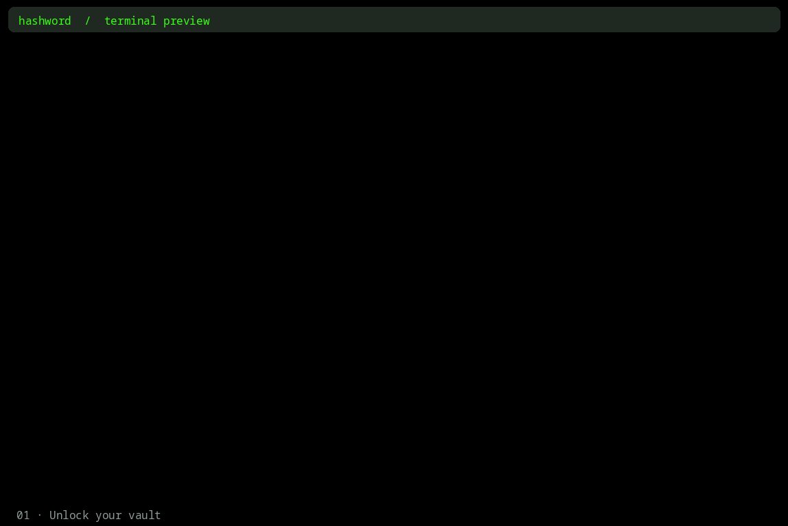

<div align="center">
  
</div>

<h4 align="center">A terminal UI preview for a wallet and password manager.</h4>

---

Hashword is a terminal UI application for managing wallets and passwords. It is designed to be simple, secure, and fast. It uses a local SQLite database to store encrypted secrets, and it supports multiple wallets and accounts. It's familiar to vim users, and has a retro style terminal design, but with a modern and responsive interface like terminal.shop (terminal coffee).



## Install and Using This Application

Install Node.js 22 or newer, then download and extract this repository. 

```sh
# In the project folder:
cd hashword
npm install
npm ci
npm run build
npm link
```

From any folder, run:

```sh
hashword
```
## Installing and Running for Development

```sh
# In the project folder:
cd hashword
npm install
npm ci
npm run dev
```
