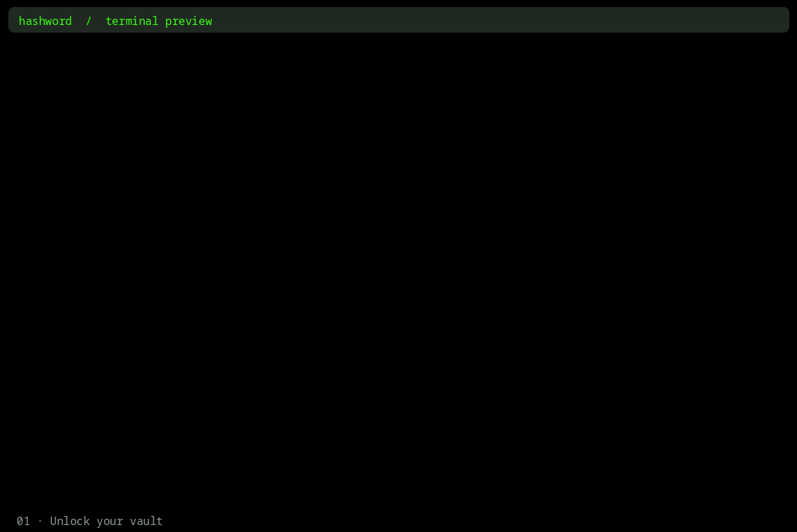

<p align="center"></p>

<h4 align="center">A Wallet & Password Manager for your computer</h4>

<p align="center">
  <a href="https://hashword.site"></a>
  <a href="https://hashword.site"></a>
</p>

---

<p align="center"></p>

## Run the website

Use Node.js 22 or newer. From the repository root:

```sh
cd web
npm ci
```

Copy `web/.env.example` to `web/.env.local` if that file does not already exist.
Set the Neon `DATABASE_URL`, a random `BETTER_AUTH_SECRET`, and
`BETTER_AUTH_URL=http://localhost:3000`. Generate a secret with:

```sh
openssl rand -base64 32
```

Then, from `web/`:

```sh
npx auth@latest migrate --config ./auth.ts
npm run dev
```

Open http://localhost:3000 and choose Register. Keep `.env.local` private.
See [website setup and troubleshooting](web/README.md) for the complete flow.

## Run the CLI

From the repository root:

```sh
cd cli
npm ci
npm run dev
```

Run the website first. The CLI defaults to `http://localhost:3000`; set
`HASHWORD_API_URL` to the deployed website's HTTPS origin when needed.
Enter your username and account password. `Tab` switches fields, `Enter` advances
or submits, `L` signs out from the vault screen, and `Ctrl+Q` exits. To install the local command:

```sh
npm run build
npm link
hashword
```

## Checks

Root scripts target the CLI:

```sh
npm test
npm run typecheck
npm run build
```

Run website checks separately:

```sh
npm --prefix web test
npm --prefix web run typecheck
npm --prefix web run lint
npm --prefix web run build
```

## Next steps

Implement authenticated vault storage in the web backend, then connect both
interfaces to the same vault API. The CLI should only handle input, API requests,
and displaying results. See the [current implementation plan](docs/neon-implementation-plan.md).
