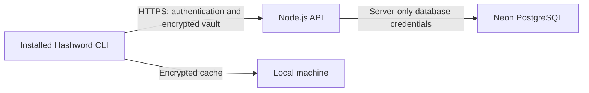

# Neon integration plan for Hashword

Status: implementation proposal; no database resources provisioned or application behavior changed.

## Target experience and architecture

A user registers, logs in with a username and account password, and unlocks their vault with a separate master key. Their encrypted vault lives in Neon and can be downloaded on another machine. The installed terminal app encrypts and decrypts vault contents locally. The backend never receives the master key or decrypted vault contents.



Proposed stack: existing React/Ink CLI; separate Node.js/TypeScript API using Fastify; Better Auth with username and bearer-session support; PostgreSQL in Neon; versioned SQL migrations. The backend host can be chosen separately from the database host. Keep its region near Neon.

Use self-hosted Better Auth backed by Neon for the initial implementation. Neon also offers managed authentication, but do not assume that its managed configuration supports every plugin needed for this CLI. Validate username login and bearer-session behavior in an early integration spike before committing to package versions.

Scope for the first release: online registration/login, locally encrypted cloud storage, explicit saving and conflict detection. Add encrypted offline caching after the online flow passes integration tests. Do not build automatic multi-device merging initially.

## Current application integration points

- `hashword/src/ui/App.tsx`: replace `verifyMasterKey(value === "password")`, example-state initialization, and synchronous login with a session controller. Its current lock action leaves decrypted entries in parent state; change that to clear vault state as well as close the page.
- `hashword/src/ui/LoginPage.tsx`: add username/account-password login, registration, and a separate master-key unlock screen, with loading/error states.
- `hashword/src/ui/VaultPage.tsx`: retain navigation, masking, block cursor, and master-key prompts. Make verification and saving asynchronous. Await a save result before closing the editor; retain the draft on failure.
- `hashword/src/ui/vaultData.ts`: retain field templates/types, move example records to an explicit demo fixture, and add stable entry/field IDs plus a versioned vault document schema. Real accounts start with an empty vault, not example secrets.
- `hashword/src/index.tsx`: initialize configuration/session services and cleanup on exit.
- Account tab: display the authenticated username and a change-password action. Never display or retrieve the account login password. Changing username/password uses authenticated account endpoints, rather than generic vault-field editing. Keep the account password and vault master key independent.

Proposed files:

```text
server/src/app.ts                 # API composition, request limits, error handling
server/src/auth.ts                # Better Auth integration and session verification
server/src/db.ts                  # Neon/PostgreSQL connection
server/src/routes/vault.ts        # Owner-scoped encrypted vault operations
server/migrations/                # Auth schema and application migrations
server/.env.example              # Placeholder server settings only
hashword/src/lib/api.ts           # HTTPS requests and validated responses
hashword/src/lib/auth.ts          # CLI login/logout/session handling
hashword/src/lib/vaultCrypto.ts   # Key derivation, key wrapping, encryption
hashword/src/lib/vaultSchema.ts   # Vault and encrypted-envelope validation
hashword/src/lib/vaultStore.ts    # Download, save, revision, dirty state
hashword/src/lib/localCache.ts    # Later: atomic encrypted cache operations
hashword/src/ui/UnlockPage.tsx
hashword/src/ui/RegisterPage.tsx
```

## Phase 1: provision Neon and the API skeleton

1. Create a Neon project and separate development and production environments. Use synthetic data for development; production branches may contain sensitive account metadata even when vaults are encrypted.
2. Create application and migration roles. Keep schema-changing permissions out of the runtime role.
3. Store the pooled runtime `DATABASE_URL`, migration connection string, authentication secret, and canonical API URL in server-side environment configuration. Use TLS. Use a direct connection for migrations where required by the migration tool.
4. Add server build/typecheck/test commands and a health endpoint. The CLI receives only an API base URL; never ship database credentials, administrator keys, or authentication signing secrets in the npm package.
5. Add migrations, validate them against development Neon, and verify startup/connection failures produce safe errors without printing credentials.

Acceptance: the API can access development Neon; the CLI package contains no database credentials; migrations run from a clean database.

## Phase 2: authentication and ownership

1. Configure Better Auth with its supported database adapter, username plugin, and bearer plugin. Use its generated/versioned authentication schema and password/session lifecycle instead of custom password hashing or token generation.
2. Prototype register, username/password login, authenticated request, logout, and session expiry from a Node CLI. Registration should collect a real recovery email if the selected auth configuration requires it.
3. Configure login rate limits, generic authentication errors, session expiry/revocation, and account-password reset. Ensure request bodies and authorization headers are redacted from logs.
4. Keep tokens in memory in the first release. Add OS credential-store persistence only as a separate feature; never store bearer tokens in a plaintext config file or encrypted vault payload.
5. Every vault query must scope ownership to the server-verified session user ID. Never trust a client-provided owner ID. Add PostgreSQL row-level security as defense in depth only with a tested role and transaction-scoped identity design; table owners and privileged roles can bypass RLS.

Acceptance: user A cannot read or overwrite user B's vault; expired/revoked sessions fail; typing p/w/a in login or master-key input never switches tabs.

## Phase 3: local vault encryption

Use an established maintained cryptographic implementation, pin dependencies, and validate it with known-answer tests. Do not implement cryptographic primitives manually.

1. Generate a random 256-bit vault data key on the machine.
2. Derive a wrapping key from the separate master key with Argon2id and a random per-vault salt. Benchmark parameters on supported machines and store a versioned parameter set. Enforce bounded, supported parameters when reading remote data to prevent excessive memory/CPU allocation.
3. Wrap the data key using authenticated encryption. Encrypt the whole versioned vault document with AES-256-GCM. Generate a fresh random 96-bit nonce for every encryption under a key; never reuse one. Store authentication tags and nonces with ciphertext. Authenticate envelope version and stable vault/owner identifiers as associated data.
4. Encrypt entry names, sections, field labels, and field values, including non-sensitive fields. Neon receives one opaque vault document; field sensitivity controls UI masking rather than whether a field is encrypted.
5. Verify master-key prompts locally by successfully unwrapping the stored data key. Replace the synchronous verification callback with an async service and disable duplicate submissions while verification runs. Wrong-key or corrupted-data errors must not reveal contents.
6. On lock/logout/exit, clear decrypted React state, drafts, revealed fields, and key references; overwrite mutable key buffers where feasible. JavaScript strings and garbage collection prevent guaranteed memory erasure, so do not claim otherwise.

Re-entering the master key for reveal/edit remains a local confirmation. The process already has access to the unlocked vault; this UI confirmation is not protection against a compromised running machine.

Acceptance: wrong master keys and modified ciphertext fail authentication; round trips preserve Unicode, empty fields, and all sections; no plaintext vault data enters API requests, logs, cache files, or crash reporting.

## Phase 4: database schema and HTTP contract

Better Auth owns its users/credentials/sessions tables. Add one application vault row per user initially:

| Column | Purpose |
| --- | --- |
| `id` | UUID vault identifier |
| `owner_id` | Unique foreign key to the actual generated auth user ID type |
| `envelope` | Validated JSONB: format/crypto version, KDF salt and parameters, wrapped data key, nonces/tags, encrypted document |
| `revision` | Monotonic integer used for conditional updates |
| `created_at`, `updated_at` | Server-managed timestamps |

Use base64 for binary envelope values. Enforce request-size limits, envelope shape, encoding, supported versions, and nonce/tag lengths. The server validates structure but cannot inspect encrypted vault contents.

Keep account identity/password operations in the auth service. Add these application routes:

- `POST /v1/vault`: authenticated creation; unique owner constraint; retries must not overwrite an existing vault.
- `GET /v1/vault`: return the caller's encrypted envelope and revision, or a clear not-initialized response.
- `PUT /v1/vault`: accept encrypted envelope and expected revision. Perform an atomic owner-scoped update with `WHERE revision = expectedRevision`; increment revision and return it. Return `409` on a revision conflict.

Treat encrypted content and its key metadata as one atomic unit. A master-key change rewraps the data key and updates that envelope using the same revision protection.

Acceptance: concurrent saves cannot silently overwrite each other; retries after ambiguous network failures can be reconciled by fetching the latest revision and comparing the submitted envelope.

## Phase 5: connect the UI and persistence flow

1. Registration creates the auth account, then initializes the encrypted vault after local master-key confirmation. If vault creation fails, the user can log in and resume initialization without duplicate accounts or destructive replacement.
2. Login obtains a session, downloads the encrypted envelope, and shows the unlock screen. Unlock decrypts into the existing password/wallet UI.
3. Saving a field validates the draft, creates the next vault snapshot, encrypts it locally, and submits it with the current revision. Initially serialize writes and permit only one pending save.
4. Show saving/saved/failed status in the bottom area. On failure preserve the draft and provide retry/cancel. For `409`, retain the local draft and require an explicit reload/reapply action; do not automatically overwrite the other device's changes.
5. Sensitive Enter/reveal and i/edit both await local master-key verification. Editing stays masked with a moving block cursor. Esc cancels; Ctrl+L clears the unlocked vault; Ctrl+Q exits. During an in-flight save, define completion/cancellation behavior and do not imply an unacknowledged save succeeded.
6. Reopen the app and verify that logging in/unlocking restores saved data. Test the same account from a second app instance.

Acceptance: edit → save → quit → restart → login → unlock restores all values. A second user sees none of them. Account password changes never mutate the master key or generic vault fields.

## Phase 6: encrypted local cache, recovery, and release

- Cache only the encrypted envelope plus revision, scoped by account ID. Use atomic replacement and restrictive file permissions. Offline unlocking needs an existing cache and master key; first-time login still needs the network.
- Start with explicit offline/read-only behavior. Offline editing and automatic synchronization need a separate conflict/retry design.
- Support encrypted export/import and document restore procedures. Verify the chosen Neon plan's backup retention and practice a restore; do not assume plan-specific backup guarantees.
- Account-password reset restores authentication only. It must not claim to recover the vault master key. Initially document that a forgotten master key loses vault access; separately design and test a recovery-key mechanism before offering recovery.
- Add inactivity locking, dependency review, authorization tests, request-redaction checks, and a packaged CLI smoke test. Obtain a security review before inviting storage of real wallet keys/recovery phrases.

## Recommended delivery order

1. API + Neon development environment + CLI authentication spike.
2. Client encryption module and security tests.
3. Vault schema/API with ownership and revision tests.
4. Replace demo login/state and connect save/load/master-key prompts.
5. Account settings and full two-user/two-device verification.
6. Encrypted cache, export/restore, production deployment, and security review.

First milestone: two registered users can independently save an encrypted vault, quit, and restore it after login; neither can read or overwrite the other's data, and neither database contents nor request logs expose vault plaintext.

## References checked for this plan

- Neon connections: https://neon.com/docs/connect/connect-from-any-app
- Neon managed authentication: https://neon.com/docs/auth/overview
- Better Auth plugins (username and bearer): https://better-auth.com/docs/plugins
- OWASP cryptographic storage: https://cheatsheetseries.owasp.org/cheatsheets/Cryptographic_Storage_Cheat_Sheet.html
- OWASP password storage: https://cheatsheetseries.owasp.org/cheatsheets/Password_Storage_Cheat_Sheet.html
