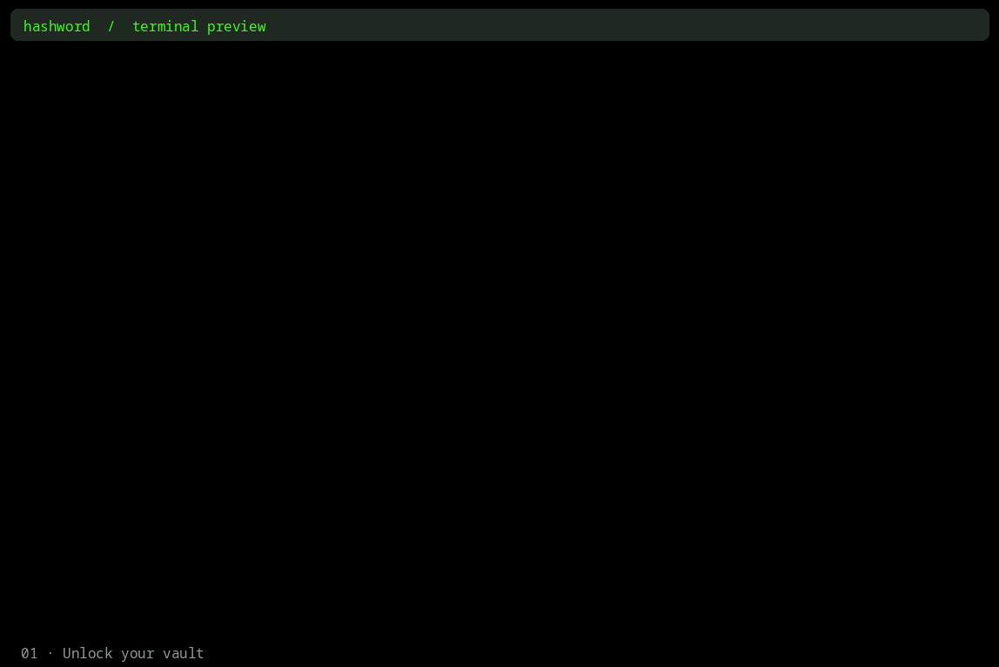

Hashword is a wallet and password manager in development, with a React/Ink terminal preview and a Next.js browser companion.



The GIF shows an earlier interface preview with illustrative records. It does not show current stored vault contents.

## What works now

The browser companion supports account registration, username/password sign-in, session restoration, and sign-out. The terminal tab contains these account controls. The API tab documents current authentication routes and a proposed vault interface.

The website and backend run in one Next.js service. Better Auth manages credentials and browser session cookies, with account data stored in Neon PostgreSQL. Database credentials stay on the server.

The CLI signs in through the web API and opens a placeholder vault screen. There is no vault editor or persistent vault storage yet.

## Shared account login

The website and CLI use the same account password through Better Auth. The CLI has no local vault encryption module or separate master password. Vault storage and access control will be provided by the web backend.

## Run the website locally

Use Node.js 22 or newer. From the repository root:

```sh
cd web
npm ci
```

Copy `.env.example` to `.env.local` if it does not exist. Set the Neon `DATABASE_URL`, a random `BETTER_AUTH_SECRET` of at least 32 characters, and `BETTER_AUTH_URL=http://localhost:3000`. Generate the secret with `openssl rand -base64 32`. Keep the file private.

From `web/`, create the authentication tables and start Next.js:

```sh
npx auth@latest migrate --config ./auth.ts
npm run dev
```

Open http://localhost:3000 and choose Register. Create a test account, sign out, sign in, and reload to verify the session. A fresh database needs the auth migration; setting its URL alone is not enough. Restart the dev server after editing environment settings.

## Run the terminal preview

From the repository root:

```sh
cd cli
npm ci
npm run dev
```

Run the website first; the CLI defaults to http://localhost:3000. Set HASHWORD_API_URL for a deployed HTTPS backend. Enter your username and account password; Tab switches fields, Enter submits, L signs out, and Ctrl+Q exits.

To install the local command, run these from `cli/`:

```sh
npm run build
npm link
hashword
```

## Future work

Next is backend vault storage and authenticated vault read/write routes shared by the website and CLI. Account-password reset and email-verification delivery are not configured yet.

## Development checks

Root `npm test`, `npm run typecheck`, and `npm run build` target the CLI. Run the website's `test`, `typecheck`, `lint`, and `build` scripts from `web/`. API client tests mock HTTP; live authentication needs the configured backend.
